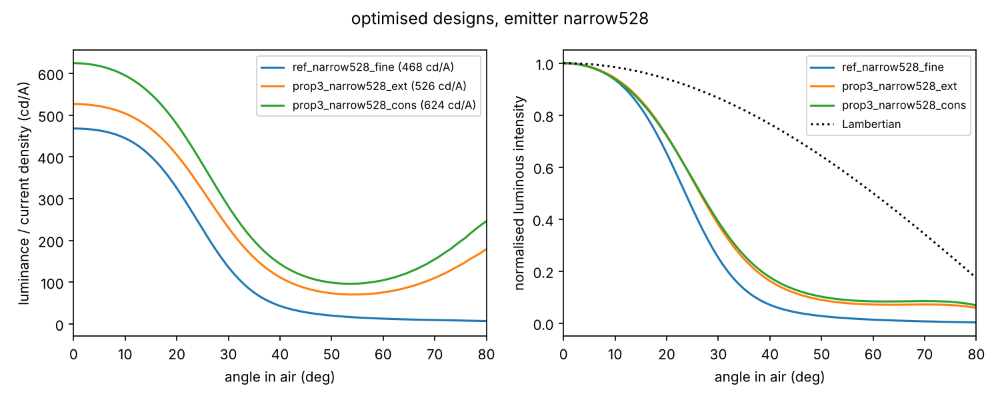
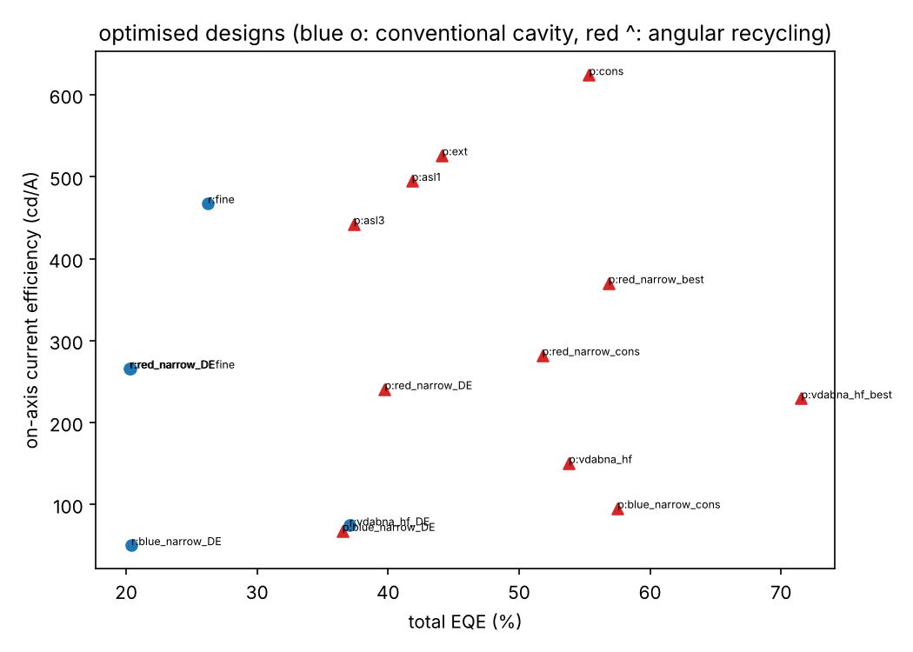
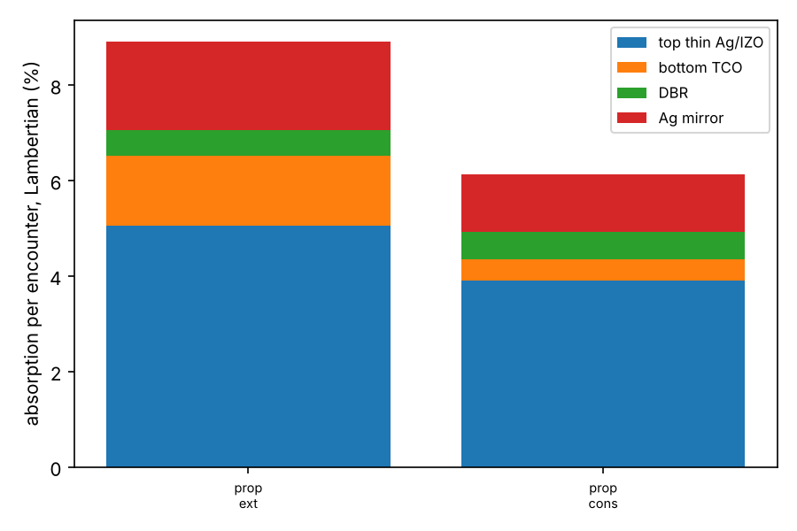

# 각도 선택 다중통과 재순환(angle-selective multi-pass recycling) TEOLED — 후속 연구 검토 보고서

> 대상: "Minimizing round-trip loss for near-unity quantum efficiency in OLEDs" 후속 연구
> 제안 구조(아래→위): Ag 반사판(전극 아님) / 재분배층(SL) / ITO·IZO(음극, inverted) / ETL / EML / HTL / HATCN / thin Ag(양극) / DBR
> 작성: 2026-11-12. 시뮬레이션 코드와 결과는 이 폴더(`recycling_sim/`)에 있음.

## 0. 요약

> 용어: 1편 원고는 식 (2)를 재흡수·재방출형 "photon recycling"(GaAs, PeLED)과 구분했습니다. 이 보고서도 그에 맞춰 **"각도 선택 다중통과 재순환(angle-selective multi-pass recycling)"**이라고 부르고, η_rec는 1편의 η_sta에 대응합니다.

**1. 물리.**
- 제안 구조는 두 금속 거울 사이의 코히런트 강공진이 아닙니다. 상부 필터(thin Ag + DBR)와 SL·Ag 반사판이 만드는 **비코히런트 적분 공동**입니다.
- 정면 휘도는 L(0) = T₀Φ₁ / (πn_m²[p + (1 − p)A′])입니다. 이전 논문 식 (2)에 **필터 자체의 흡수**를 더한 확장입니다.
- **정면 cd/A의 상한은 A′ 하나로 정해집니다**: p → 0이면 L(0) → T₀Φ₁/(πn_m²A′). A′/p는 그 상한 대비 도달률(= η_rec, 즉 EQE)을 정합니다.
- 그래서 1차 레버는 A′ 절대값을 낮추는 것이고, 콘(p)은 A′ 근처까지만 좁히는 것이 효율적입니다. 시뮬레이션 설계들은 p ≈ 0.06–0.09이고, 그중 약 1/4은 고각 사이드로브 누설입니다.

**2. 정량 비교.**
- 조건: repo의 측정 nk, 녹색 528 nm / FWHM 25 nm, Θ = 0.8, PLQY = 1, 유기층 무흡수.
- 최적화 방식: 기준은 DE + 정밀격자 국소 정련, 제안은 DE + 국소 정련, 변형들은 국소 정련입니다. 설계 간 ±2–3%는 최적화 불확도입니다.

| 소자 | 정면 cd/A | ±20° EQE | 총 EQE |
|---|---|---|---|
| 기존 강공진 TEOLED(같은 유기층·같은 HATCN/Ag 양극) | **468** | 12.0% | 26% |
| 제안 — 원안 구조(HATCN 위 15 nm Ag nk를 10 nm에 적용) | **526** (×1.12) | 13.5% (×1.13) | 44% |
| 제안 — 같은 구조, DB의 다른 12 nm Ag nk(n ≈ 0.20–0.28) 적용(별도 재계산) | ~430–470 (×0.92–1.01) | – | – |
| 제안 — A′ 개선 가정(7 nm Ag가 n = 0.146 유지, ≥500 nm 저굴절 spacer(ODR), ITO k ≈ 0.001) | 624 (×1.33) | 15.9% (×1.33) | 55% |
| 제안 — 위와 같되 문헌 수준 7 nm Ag(n ≈ 0.19–0.25)(별도 재계산) | ~525–580 | – | ~47–51% |
| 제안 — 낙관적(12 nm `test5` nk n = 0.092를 7 nm에, + 저굴절 HTL) | 690–760 | 17.5–18.9% | 60–63% |
| 제안 — 상부 양극을 무손상 IZO ~59 nm로(가정) | 634 | 16.6% | **72%** |
| (참고) 손실 0 이상 극한(같은 필터 설계) | ~1,130 | – | 93% |

**3. 해석 — 무엇이 확실하고 무엇이 불확실한가.**
- **확실한 것**
  - 같은 정면 휘도를 **EQE를 희생하지 않고**(총 EQE ×1.4–2.3) 낼 수 있습니다. 강공진은 cd/A를 위해 EQE를 26%까지 희생합니다.
  - 다만 총 EQE 증가분의 70–80%는 30° 밖(DBR 사이드로브)으로 나갑니다. 따라서 **헤드라인은 총 EQE가 아니라 "정면 cd/A + 콘 내(±20/30°) EQE"**여야 합니다.
- **불확실한 것**
  - 현재 재료(10 nm Ag)에서 정면 cd/A 이득은 **−8%~+12%**입니다. thin Ag의 n이 지배하므로, **HATCN 위 실제 두께 Ag의 nk 실측이 판정의 선결 조건**입니다.
- **확실한 이득(정면 cd/A·±20° EQE ×1.3 이상)의 조건**
  - A′ ≲ 0.06이어야 합니다: thin Ag n·d ≲ 1 nm 또는 저손상 상부 TCO, ≥500 nm ODR spacer, low-k TCO, k ≲ 10⁻⁴ 유기층.
  - n_m ≥ 1.8이어야 합니다(1.70이면 기준 이하).
  - 사이드로브 억제가 필요합니다.
- **민감도**
  - 유기층 k 10⁻³(두꺼운 HTL): −16%
  - DBR 두께 ±2%: −7~9%. 유기층 두께에는 강건하므로 in-situ 광학 모니터링이 필요합니다.
- **모델 → 실험 환산**: 같은 모델의 기준 소자(468)가 실측 최고 TE 기록(378.4)보다 24% 높으므로 환산 계수는 ≤ ~0.8입니다.
  - 실험 기대치: 현재 재료 **~350–460 cd/A**, thin Ag 개선 시 **~410–510 cd/A**.
  - 그래서 핵심 목표는 절대값보다 **같은 배치의 최적 강공진 대조군 대비 정면 cd/A ≥1.1–1.3×, ±20° EQE ≥1.1–1.3×, 총 EQE ≥1.5×**입니다.

**4. A′ 예산과 전극.**
- 526 설계에서 상부 스택 1회 입사당 흡수(Lambertian 평균): thin Ag 5.1%, ITO 1.5%, DBR 0.5%, 하부 Ag 반사판 1.9%.
- **thin Ag 손실만 없애도 776–875 cd/A**입니다. 손실을 하나씩 없앴을 때의 레버 순서는 thin Ag ≫ 반사판(+8–12%) > TCO(+3–10%) > DBR(<1%)입니다.
- **효과가 큰 레버**
  - thin Ag n(550): 0.146 → 0.092면 +11%.
  - n·d ≲ 1 nm. 7–9 nm + 핵생성층(MoO₃ 1 nm, 4-aminopyridine, Au 1 nm). Ge·Ni·Al seed는 피하세요.
  - **반사판 아래 ≥500 nm 저굴절 spacer**(ODR, omnidirectional reflector). 200–300 nm는 Otto형 SPP 결합으로 오히려 나쁩니다.
  - 상부 TCO를 완전히 배제하지는 마세요: Forrest 그룹은 버퍼 위 스퍼터 ITO/IZO로 EQE 30–37%를 냈습니다. 시뮬레이션의 무손상 IZO 상부 양극은 EQE 72%입니다.

**5. 산란층 대안과 블러.**
- 1순위: 평탄 Ag + 두꺼운 저굴절 spacer + 얇은 고굴절 재분배층(μs′·d ≳ 1, 현실적으로 1.5–2 µm).
- 그 위 sub-layer 후보: 상관 무질서 나노디스크 단층, SiNx 내 진공 nanohole.
- MLA·격자·메타표면은 1편 ED Fig. 1b(MLA는 빛을 대체로 원래 각도로 되돌림)에 근거해 불리할 **가설**이며, BSDF로 정량 비교가 필요합니다. 거친 Ag는 피하세요.
- 블러: SL 1–2 µm에서 r50/r90 ≈ 8–12 / 22–31 µm입니다(하한 추정: Goos–Hänchen 이동을 ±10 µm로 clip).
  - 500 ppi RGB에서도 재순환광의 ~40–50%가 이웃 부화소로 샌다는 추정입니다. 따라서 **화소별 반사 뱅크가 필요**하고, 그 측벽 흡수는 A′에 추가됩니다(미모델).

**6. 선행연구.**
- "Qu et al. ACS Photonics"는 **Qu, Coburn, Fan, Forrest, *ACS Photonics* 4, 363 (2017)**로 보입니다.
- 더 가까운 것은 **Jongchan Kim, Qu, Coburn, Forrest, *ACS Photonics* 5, 3315 (2018)**입니다(투명/투명 TEOLED + n≈1.8 평탄화층 + 확산 반사판, EQE 15→37%).
- 특허
  - 반사판/저굴절층/산란층/투명전극 TEOLED 적층: Kodak US6965197B2 청구항 20–21(만료).
  - 투명전극 아래 확산 반사판: Michigan US10770690B2.
  - 각도·파장 선택 반사 + 재순환(색보정 목적): Microsoft US10586833B2. 둘 다 ~2038년까지 유효로 표시됩니다.
- 1편 원고의 outlook도 이미 TE 화소용 저손실 반사 전극 + 저-n 초박막 Ag 또는 저손상 산화물 + 나노입자 산란층을 제안했습니다.
- 따라서 **신규성은 "스택 내 각도 선택 필터 + 필터 흡수를 포함한 A′/p 정량 이론의 실증"**에 걸려 있습니다.

**7. 발광체와 첫 실험.**
- **첫 개념 검증은 실험실의 Ir(ppy)₂acac 스택 + 5.4절 대조군**으로 하세요.
  - 새 재료가 필요 없습니다.
  - 넓은 스펙트럼에서 강공진이 더 빨리 무너져 상대 이득이 가장 큽니다(×1.5; 기준은 국소 최적).
- 기록용은 **협대역 녹색(≤25 nm, 528–535 nm) PSF**입니다.
  - 카탈로그 상품으로는 사실상 없으므로(2PTZBN은 EL ~58 nm) 공동연구나 위탁합성이 필요합니다.
  - 구매 가능한 협대역: 청 ν-DABNA·t-Bu-ν-DABNA(Ossila, 승화), 청록 BN-CP1(미승화).

**8. 색 전략.**
- 정면 효율 이득은 **녹색에서만 뚜렷**합니다: 녹 cd/A ×1.12–1.33, 청 BI ×0.94–1.02, 적 ×0.91–1.06.
- 따라서 **녹색 기록 → 청·적은 같은 CIE에서의 콘 내 EQE로 일반성** 순서를 권합니다.
- 청색을 주력으로 삼는 것은 비추천입니다. 청색 cd/A 최적화는 색을 녹색 쪽으로 옮기는 "게이밍"이 실제로 일어났으므로(2.7절) 반드시 BI(= cd/A ÷ CIE y)로 하세요.

**9. 저널.**
- **Nature Photonics는 조건부 목표**입니다. 조건은 다음 네 가지입니다.
  1. A′ ≲ 0.06 실증
  2. 같은 배치의 최적 강공진 대비 정면 cd/A와 ±20° EQE 각각 ≥1.3×
  3. 독립 측정한 A′로 G·η_rec를 정량 예측·검증
  4. 사이드로브 억제
- 현재 재료 수준의 결과라면 *Light Sci. Appl.*, *Adv. Mater.*, *Nat. Commun.*이 현실적 상한입니다.
- Nature/Science는 VR pancake 시스템 수준의 nits/W·수명 데이터까지 있어야 하는 stretch입니다.
- 1편이 accept/preprint된 뒤, 1편의 TE 전망과 구별되는 기여를 명확히 해서 투고하세요.

**10. 부수 발견.**
- repo MATLAB 스크립트의 `exp_phase`는 n_sub > n_EML일 때 이중 계산입니다. 무손실 스택에서 에너지가 2.7–4.7% 사라집니다(9절).

---

## 1. 개념의 물리 — "강한 정면 캐비티"는 어디서 오는가

### 1.1 코히런트 캐비티가 아니라 비코히런트 적분 공동이다

제안 구조에서 하부 ITO/IZO는 고굴절 SL(n_m ≈ 1.8)에 굴절률 정합되어 **아래쪽이 광학적으로 열려 있습니다.**
따라서 발광층이 보는 것은 상부 거울(thin Ag + DBR) 하나뿐인 **half-cavity**이고, 통상 TEOLED처럼
두 금속 거울 사이 공진으로 Purcell 재분배가 일어나는 구조가 아닙니다.

- 정면 선택성은 **상부 스택 자체의 필터 특성**에서 나옵니다. 최적화된 설계에서 thin Ag + ZnS/LiF DBR은
  "induced-transmission filter"처럼 동작해서, 정면 투과 T₀(피크 파장 0.92, 발광 스펙트럼 평균 ~0.70)를 주면서 사선광은 반사합니다.
- 반사된 빛은 SL로 내려가 방향이 바뀌고, Ag 반사판에서 돌아와 다시 필터에 도전합니다.
  이것은 LCD 백라이트의 BEF/DBEF 재순환, Schnitzer–Yablonovitch의 textured thin-film LED,
  각도 제한 태양전지(Kosten 2013)와 같은 **integrating-cavity 물리**입니다.
- 하부에 부분 거울(예: TiO₂/SiO₂ DBR)을 넣으면 코히런트 공진과 재순환을 결합한 하이브리드가 됩니다(2.2절; 이번 계산에서는 이득 없음).

### 1.2 지배 방정식 — 이전 논문 식 (2)의 확장

한 번 상부 스택을 만날 때(Lambertian 평균) 공기로 탈출할 확률을 p, 흡수를 a_t, 반사를 r = 1 − p − a_t,
반사판+SL 왕복 반사율을 R_b라 하면:

- **재순환 추출효율**: η_rec = p / [p + (1 − p)A′],  A′ ≡ 1 − R_b·(1 − a_t/(1 − p))
  - 이전 논문의 η_sta와 같은 꼴입니다. 다른 점은 **outcoupling 구조(상부 필터) 자체가 손실(thin Ag)을 가진다**는 것입니다. 그래서 a_t가 A′에 들어갑니다.
- **정면 radiance**(복사휘도 정리, L/n² 보존): L(0) = T₀·Φ₁ / (π·n_m²·[p + (1 − p)A′])
  - Φ₁은 처음 SL로 들어간 광자 수입니다.
- **같은 광자를 Lambertian으로 낸 경우 대비 정면 이득**:
  G = T₀ / (n_m²·[p + (1 − p)A′])  ≤  T₀/(n_m²·p) ≈ 1/sin²θ_c
- **cd/A** = (683/π)·⟨V(λ)·hc/(eλ)⟩·Φ₁·G + (직접 방출분)

이 식에서 나오는 설계 결론은 네 가지입니다.

1. **정면 cd/A의 상한은 A′가, 그 상한에의 도달률(= η_rec, EQE)은 A′/p가 정합니다.**
   - A′ ≫ p이면 L(0) → T₀Φ₁/(πn_m²A′)로 포화합니다. 이때는 필터를 더 좁혀도 정면 휘도는 늘지 않고 EQE만 줄어듭니다.
   - 반대로 p ≫ A′이면 콘을 좁힐수록 정면 휘도가 1/p로 커집니다.
   - 정면 콘이 좁아 p가 0.06–0.09로 작으므로(MLA의 p ≈ 0.4 대비) **A′ 요구가 이전 논문보다 훨씬 엄격합니다.**
2. **n_m²가 손실 예산을 조입니다.** 고굴절 매질 안의 등방 광자 분포(photon gas)는 étendue가 n_m²배 크므로, p ≫ A′일 때 같은 탈출을 위해 n_m²배 더 많이 왕복해야 합니다(일반적으로 왕복 횟수 N ≈ 1/(p + A′)). n_m을 무조건 높이는 것이 답이 아닌 이유입니다(최적 n_m ≈ 1.8 근처).
3. **이상적 상한은 발광 선폭이 정합니다.**
   - 간섭 필터의 공진은 λ(θ) = λ₀·√(1 − sin²θ/n_eff²)로 이동하므로 sin²θ_c ≈ 2n_eff²·Δλ/λ, 즉 G_max ≈ λ/(2n_eff²·Δλ_eff)입니다.
   - 여기서 Δλ_eff = ∫s dλ / s_max는 FWHM이 아니라 **유효 선폭**입니다.
   - 528 nm, FWHM 25 nm + 진동 숄더 15%면 Δλ_eff ≈ 32 nm입니다. n_eff ≈ 1.7이면 G_max ≈ 2.8, 즉 손실 0·광자 100%일 때 **약 1,150–1,200 cd/A**입니다.
   - 이 G_max는 단일 간섭 필터를 가정한 **추정치이지 엄밀한 상한이 아닙니다**. 2.3절의 무손실 계산(1,129 cd/A, EQE 93%)에서도 광자의 ~28%가 45° 밖(사이드로브)으로 나갑니다.
   - 따라서 남은 여지는 **A′ 감소와 사이드로브 억제(필터 대역 설계)** 두 갈래이고, 상한 자체를 올리려면 유효 선폭을 줄이거나(숄더 억제) 필터의 n_eff를 낮춰야 합니다.
   - 코히런트 강공진도 같은 étendue 상한을 공유합니다. 두 방식의 차이는 어떤 손실이 상한 접근을 막느냐입니다. 강공진은 waveguide/SPP로 갇힌 빛을 잃고, 재순환은 그 빛을 되살리는 대신 왕복 흡수를 치릅니다.
4. **편광 재순환(반사형 편광자)의 이득**은 G_RP = [p + (1 − p)A′] / [p/2 + (1 − p/2)A′]입니다.
   - A′ ≪ p일 때만 2배에 가깝고, 이번 설계들(A′/p ≈ 0.6–1.2)에서는 1.27–1.43배입니다.
   - 2배가 되지 않는 이유: photon gas의 radiance가 A′로 정해지면, 버린 편광을 되돌려도 gas가 더 밝아지지 않습니다.

---

## 2. 시뮬레이션 결과 (repo의 `nk_JH_total.mat` 측정 광학상수 사용)

### 2.1 방법과 검증

**모델**
- 이방성(uniaxial) TMM: 접선 E 규약, 안정적 Airy 재귀, 층별 흡수는 Poynting flux로 계산합니다.
- 고전 dipole 모델(Furno/Neyts): 발광 에너지를 공기 직접 / SL 하향 / 손실(SPP·흡수)로 분리합니다.
- 재순환: 완전 무작위화 해석 모델 + HG 산란 Monte Carlo(측방 PSF, Goos–Hänchen 이동 포함).
- 스펙트럼 가중: homogeneous broadening(s₀·F/F̄).

**재료**
- 하부 Ag 반사판: McPeak(k = 3.61 @550).
- 상부 thin Ag: **HATCN 위 15 nm 실측(n = 0.146 @550)**.
- ITO: König(k = 0.0032). 유기물: B3PyMPM / TCTA:B3PyMPM / TCTA / TAPC의 o/e 실측값.
- DBR: ZnS / LiF(k-floor 10⁻⁴).

**조건**
- 발광: 528 nm, FWHM 25 nm 가우시안 + 진동 숄더(MR-TADF 모사), Θ = 0.8, PLQY = 1.
- 하부 SL은 n_m의 반무한 매질(dipole 계산)이자 무작위화 매질(재순환 계산)로 취급했습니다.

**검증** (별도 코드로 독립 구현해 교차검증; 테스트 스크립트는 리뷰 과정에서 작성)
- TMM: MATLAB 규약 독립 포트와 1e-13까지 일치. expm 기준해와 300개 무작위 스택에서 일치.
- dipole 모델: 6자리까지 일치.
- 무손실 스택 에너지 보존 1.00000. Drexhage/CPS 해석해와 일치(수직 쌍극자는 u = 1 특이점 때문에 √du로 수렴).
- radiance 정리: 반구 적분 = EQE.
- MC는 강산란 극한에서 해석 모델과 1–3% 이내로 일치합니다.
- **주의 1 (aliasing)**: 고-Q 기준 캐비티는 4 nm·du = 1e-3 격자에서 목적함수가 6%(DBR 캡은 최대 60%) 부풀려집니다. 아래 표는 모두 **2 nm·du = 2.5e-4 정밀격자로 재평가한 값**입니다.
- **주의 2 (EML 등방 근사)**: EML(TCTA:B3PyMPM, n_e = 1.68)을 등방(n_o = 1.84)으로 근사해 절대 cd/A가 4–7% 과대평가됩니다. 기준 소자에 더 크게 작용하므로 제안/기준 비율은 약간 보수적입니다.

### 2.2 녹색(528 nm / 25 nm) — 기준 소자 vs 제안 구조

모든 값은 정밀격자로 재평가했습니다.

| 설계 | 정면 cd/A | 총 EQE | EQE ±20° | EQE ±30° | p | A′ | T₀(peak) | G |
|---|---|---|---|---|---|---|---|---|
| **기준: 강공진 TEOLED**(Ag/ITO 하부, HATCN/Ag + NPB CPL; 정밀격자 국소 최적: ETL 162 / HTL 179 / **Ag 30 nm** / CPL 76) | **468** | 26.2% | 12.0% | 20.1% | – | – | – | – |
| 기준 + 상부 DBR 캡(thin Ag/DBR 강공진; 국소해) | 459 → **≈387**(0.5 nm 격자로 재평가하면 수렴하지 않음) | 20.5% | 9.5% | 14.8% | – | – | – | – |
| 기준, thin Ag 벌크 nk | 483 → **≈463**(0.5 nm 격자 수렴값; 상한 아님) | 18.5% | 11.1% | 16.6% | – | – | – | – |
| **제안: 원안 구조**(HATCN 위 15 nm Ag 실측 nk를 10 nm에 적용) | **512–526** | **44%** | 13.5% | 23.9% | 0.077 | 0.093 | 0.92 | 1.30 |
| 제안: DBR 5쌍 | 462 | 51.8% | 12.2% | 23.0% | 0.108 | 0.101 | 0.89 | 1.11 |
| 제안: thin Ag 7 nm(탐색 하한, seed 가정, HATCN 위 nk) | 561 | 50.7% | 14.4% | 25.7% | 0.085 | 0.081 | 0.93 | 1.38 |
| 제안: thin Ag nk = 12 nm 실측(n = 0.092) | 584 | 48.0% | 14.8% | 26.0% | 0.077 | 0.078 | 0.93 | 1.44 |
| 제안: 반사판 아래 SiO₂ 800 nm(ODR) | 544 | 45.1% | 13.9% | 24.3% | 0.075 | 0.087 | 0.91 | 1.34 |
| 제안: ITO k × 0.3 | 560 | 46.5% | 14.3% | 25.1% | 0.075 | 0.082 | 0.92 | 1.38 |
| 제안: 하부 IZO(ITO 대신) | 521 | 43.1% | 13.4% | 23.5% | 0.072 | 0.090 | 0.92 | 1.29 |
| 제안: 저굴절 HTL(n = 1.55) | 562 | 47.2% | 14.4% | 25.2% | 0.073 | 0.078 | 0.93 | 1.39 |
| **제안: 개선-보수적**(Ag 7 nm·HATCN 위 nk, ODR, low-k ITO) | **624** | **55.3%** | 15.9% | 28.3% | 0.083 | 0.064 | 0.92 | 1.53 |
| 제안: 개선-낙관적(Ag 7 nm·12 nm `test5` nk(n = 0.092; DB의 다른 12 nm 데이터는 n ≈ 0.20–0.28), ODR, low-k ITO) | 690 | 59.9% | 17.5% | 30.7% | 0.081 | 0.052 | 0.92 | 1.69 |
| 제안: 개선-낙관적 + 저굴절 HTL | 760 | 63.5% | 18.9% | 32.6% | 0.072 | 0.040 | 0.92 | 1.86 |
| 제안: SL 흡수 1%/왕복(≈ 2 µm SL에서 k ≈ 5×10⁻⁵) | 495 | 41.8% | 12.7% | 22.6% | 0.077 | 0.102 | 0.92 | 1.23 |
| 제안: SL 흡수 3%/왕복 | 442 | 37.4% | 11.5% | 20.4% | 0.077 | 0.122 | 0.91 | 1.11 |
| 하이브리드: 하부 TiO₂/SiO₂ DBR 2쌍(국소 최적) | 506 | 45.1% | 13.3% | 25.6% | 0.058 | 0.068 | 0.91 | 1.20 |
| 제안: thin Ag 벌크 nk(**도달 불가 상한**) | 683 | 50.6% | 16.9% | 28.6% | 0.067 | 0.059 | 0.96 | 1.70 |
| 제안: 벌크 Ag + ODR + low-k ITO + 저굴절 HTL(상한) | 830 | 58.0% | 19.9% | 32.9% | 0.057 | 0.037 | 0.95 | 2.07 |
| 제안: 상부 양극을 무손상 IZO 50–60 nm로(가정) + ODR | 634 | **71.8%** | 16.6% | 30.8% | 0.110 | 0.044 | 0.90 | 1.55 |

**해석**

1. **기존 강공진의 "cd/A 최적해"는 EQE를 희생합니다.**
   - 최적화는 상부 Ag를 30 nm, 3차(m = 2) 캐비티로 몰아갔고 EQE는 26%입니다.
   - 이번 국소 탐색에서는 DBR 캡 강공진이 정면 cd/A를 올리지 못했습니다(전역 결론은 아님). "정면 방향 캐비티를 더 강하게"만으로는 한계가 있음을 시사합니다.
2. **제안 구조는 측정 nk(15 nm 막)를 10 nm에 쓰면 정면 cd/A가 기준보다 +12%, 총 EQE는 1.7배입니다.** 다만 이 이득의 부호는 thin Ag n에 민감합니다. DB의 다른 12 nm 막 nk(n ≈ 0.20–0.28)를 쓰면 −8%~+1%입니다.
   - 최적 형태(526 cd/A): Ag 10 nm(하한), **ETL ~75 nm, HTL ~440 nm**, DBR = ZnS 80 / LiF 148 / ZnS 54 nm × 3쌍, n_m ≈ 1.81. 이때 정면 T₀ = 0.92입니다. (ETL ~200 / HTL ~320의 두 번째 해는 −2.6%.)
   - 반휘도각은 ~28°로 기준(~25°)보다 약간 넓습니다.
   - **50–80°에 DBR 사이드로브 누설**이 남아 있어, 70–80°에서 휘도가 정면의 20–35%입니다(그림 왼쪽 상승부). 이 누설은 p의 약 1/4을 차지하므로 대역 설계(chirp·쌍 추가)로 줄이는 것이 **다음 cd/A 레버**입니다.
3. **A′을 줄이는 만큼 정면 cd/A와 EQE가 함께 오릅니다.**
   - 같은 정면 휘도를 낼 때 전류는 현재 재료 0.89배, 개선 설계 0.62–0.75배입니다. 수명 측면의 이득으로 이어질 수 있습니다.
4. **DBR 설계는 아직 열려 있습니다.** 3쌍 균일 DBR만 전역 탐색했고, 5쌍은 국소해(p = 0.108, 색 변화)였습니다. 자유 두께나 chirp DBR을 "콘 내 EQE + 사이드로브 페널티" 목적함수로 최적화하는 것이 다음 단계입니다.
5. **하이브리드(하부 DBR 추가)는 이번 국소 탐색에서 이득을 찾지 못했습니다**(전역 탐색은 하지 않음).
6. **민감도**(별도 재계산)
   - 유기층 흡수: 두꺼운 HTL의 k가 10⁻³이면 −16%. 현재 DB의 유기층 k는 모두 0입니다.
   - SL 매질 굴절률: n_m = 1.70이면 ~422 cd/A로 기준 이하. **n_m ≥ 1.8은 필수**입니다.
   - DBR: 층 두께 ±2%면 −7~9%. 유기층 두께에는 강건합니다(강공진 대비 장점).

### 2.3 손실 채널 분해 — 무엇이 cd/A를 막는가 (기하 고정, 손실을 누적 제거)

| 단계 | 현재 재료 설계 | 개선-보수적 설계 |
|---|---|---|
| 최적화된 그대로 | 526 cd/A · EQE 44.1% | 624 · 55.3% |
| + 완전 반사판(R = 1) | 588 · 49.2% | 676 · 59.8% |
| + 무손실 TCO(k = 0) | 662 · 55.3% | 707 · 62.5% |
| + 무손실 상부 금속(n → 0) | **1,129 · 93.0%** | **1,063 · 93.4%** |

**결론: 상부 thin Ag가 단일 최대 손실원입니다.**
- 위 표는 손실을 **누적으로** 제거한 것입니다. thin Ag 손실**만** 없애면 776–875 cd/A(EQE 64–77%)이고, 모든 손실을 없애야 ~1,100 cd/A(EQE 93%)가 됩니다. 이 값은 1.2절의 선폭 상한(~1,150–1,200 cd/A)과 같습니다.
- 손실을 **하나씩** 제거했을 때의 레버 순서: thin Ag ≫ 반사판(+8–12%) > TCO(+3–10%) > DBR(<1%).
- 말씀하신 대로 **A′ = 이 연구의 핵심 변수**이고, 그중에서도 thin Ag의 n·d(n ≈ 감쇠율)가 결정적입니다.

**요구 사양으로 환산** (개선-보수적 설계 기준)

| 항목 | 요구 |
|---|---|
| thin Ag | **n·d ≲ 1.0 nm**(예: 7 nm에서 n ≲ 0.14, 9 nm에서 n ≲ 0.11). 현재 10 nm·n 0.146이면 1.46 nm |
| 유기층(HTL·ETL, 합계 0.4–0.5 µm) | k ≲ 1×10⁻⁴(도핑층 포함) |
| SL 매질 굴절률 | n_m ≥ 1.8(1.70에서 −20%) |
| ITO/IZO | k(550) ≲ 0.001. 두께는 50 nm 고정값(미최적화) |
| SL 매질 | k ≲ 5×10⁻⁵(2 µm 기준) |
| ZnS·LiF | k ≲ 10⁻⁴ |
| 반사판 | ≥500 nm 저굴절 spacer(가능하면 다공성 SiO₂) |

- 근거: ZnS k가 10⁻³이면 cd/A −5–6%, ZnS·LiF 모두 10⁻³이면 −12–14%입니다. 데이터베이스의 LiF k = 2.4×10⁻⁴를 0으로 두면 cd/A가 +3% 오릅니다.
- 반사판 spacer 두께에 따른 Lambertian 평균 손실(n_m = 1.85)

  | spacer | 손실 |
  |---|---|
  | 없음(bare Ag) | 1.9% |
  | SiO₂ 200 nm | 3.2% |
  | SiO₂ 300 nm | 2.3% |
  | SiO₂ 500 nm | 1.2% (SiO₂ k = 0 가정 시 1.1%) |
  | SiO₂ 800 nm | 1.2% (k = 0 가정 시 1.0%) |
  | 다공성(n = 1.25) 1 µm | 0.7% |

  → **얇은 spacer는 Otto 배치의 SPP 결합으로 오히려 해롭습니다.**

### 2.4 발광 선폭의 영향 (녹색)

| emitter | 기준 강공진 cd/A / EQE | 제안 cd/A / EQE | cd/A 비 |
|---|---|---|---|
| 528 nm, FWHM 25 nm | 468 / 26% | 526 / 44% | 1.12 |
| 528 nm, FWHM 40 nm | 345 / 27% | 461 / 45% | 1.34 |
| Ir(ppy)₂acac 실측 스펙트럼(FWHM ~64 nm) | 264 / 24% (국소 최적) | 400 / 46% | 1.51 |

- 두 방식 모두 선폭이 넓어지면 정면 cd/A가 떨어집니다.
- 그런데 **강공진이 더 빨리 무너집니다.** 공진 대역 밖의 스펙트럼이 정면에서 빠지기 때문입니다.
- 따라서 "재순환 이득을 보이는 대조 실험"은 실험실이 보유한 Ir(ppy)₂acac로도 가능합니다. 다만 **절대 cd/A 기록에는 협대역이 필요**합니다.
- 주의: Ir(ppy)₂acac 기준 소자는 녹색 최적해에서 출발한 국소 최적이라, 전역 최적화 시 다소 오를 수 있습니다.

### 2.5 산란층 세기와 블러 (Monte Carlo, 상부 스택 내 Goos–Hänchen 측방 이동 포함)

설계: 개선-보수적. 해석 모델의 재순환 CE ≈ 594 cd/A와 비교합니다.

| SL 두께 d | μs (µm⁻¹) | g | μs′·d | 재순환 CE | r50 / r90 (µm) |
|---|---|---|---|---|---|
| 1 µm | 2.5 | 0.75 | 0.62 | 577 | 11.0 / 29.8 |
| 2 µm | 2.5 | 0.75 | 1.25 | 579 | 11.6 / 30.7 |
| 4 µm | 2.5 | 0.75 | 2.5 | 586 | 13.2 / 35.1 |
| 2 µm | 5 | 0.6 | 4.0 | 603 | 8.1 / 22.2 |
| 0.5 µm | 10 | 0.5 | 2.5 | 576 | 6.6 / 18.7 |
| 2 µm(흡수 μa = 0.002 µm⁻¹) | 2.5 | 0.75 | 1.25 | 519 | 11.0 / 29.0 |
| 2 µm | 0.5 | 0.75 | 0.25 | 516 | 23.8 / 65.3 |

- **μs′·d ≳ 1이면 완전 무작위화 해석식과 2–3% 이내로 맞습니다.**
  - 현실적인 TiO₂ 20–30 vol% 박막은 μs′ ≈ 0.5–0.8 µm⁻¹이므로 SL은 **1.5–2 µm**가 적당합니다.
  - μs′·d ≈ 0.25처럼 약하면 −13% 손실과 큰 블러가 생깁니다.
- **블러 바닥은 SL이 아니라 코히런트 스택이 정합니다.** (Goos–Hänchen 이동을 ±10 µm로 clip했으므로 아래 값은 하한 추정입니다.)
  - 두꺼운 HTL/ETL(총 ~0.6 µm) 안에서 사선 반사광이 매번 1–4 µm씩 옆으로 이동합니다.
  - 탈출 전 평균 ~6–7회 반사하므로, SL을 아무리 얇게 해도 r50 ≈ 6–8 µm, r90 ≈ 18–22 µm가 남습니다.
- **응용별 판단** (재순환광이 정면 출력의 ~94%이므로 PSF가 곧 화소 번짐입니다. 이웃 부화소로 나가는 비율은 별도 MC 계산: 500 ppi RGB는 10×40 µm 개구·16.9×50.8 µm 셀 가정)

  | 해상도 | 이웃으로 새는 재순환광 |
  |---|---|
  | 단색 50 µm 화소 | 17–23% |
  | 500 ppi RGB 부화소 | 39–47% |
  | 1,000 ppi | 63–71% |
  | 마이크로 OLED(5–8 µm) | 대부분 |

  → **해상도와 무관하게 화소별 반사성 격벽(뱅크)이나 트렌치로 광학적 고립이 필요**합니다. 이 경우 재순환은 "화소 내부 적분구"가 되며, 이 그룹의 finite-size 연구(Kim·Kim·Yoo 2025)와 자연스럽게 이어집니다. HTL/ETL을 얇게 하면 측방 이동이 줄지만 cd/A와 트레이드오프가 있습니다.

### 2.6 편광 재순환 (반사형 vs 흡수형 편광자, 정면 cd/A 한 편광 기준)

| 설계 | 흡수형 | 반사형 | 비 |
|---|---|---|---|
| 현재 재료 | 223 | 265 | ×1.19 |
| 개선-보수적 | 267 | 328 | ×1.23 |
| 상한 설계 | 360 | 440 | ×1.22 |

- **2배가 아니라 1.2–1.4배 수준**입니다.
  - 표의 ×1.19–1.24는 거부된 편광의 재입사를 보수적으로 다룬 모델값입니다(고각 사이드로브로 나간 몫은 거의 돌아오지 못함). 여기에는 투과 편광 투과율을 반사형 0.95, 흡수형 0.90으로 둔 부품 가정분(×1.056)과 SL의 완전 편광 해소 가정이 포함됩니다.
  - 이상적 재입사(1.2절 G_RP 식, 각 설계의 p·A′ 사용)는 ×1.27–1.43입니다. 사이드로브를 줄이면 이 상한 쪽으로 접근합니다.
- VR(편광 필수)에서는 여전히 의미 있는 이득입니다. 다만 pancake 반사광이 패널로 되돌아와 고스트를 만드는 문제도 같이 평가해야 합니다.

### 2.7 청색·적색 — 그리고 "cd/A 게이밍"의 실제 사례

**사례: 측정 스펙트럼으로 cd/A를 최적화하면 색이 바뀐다**
- 측정된 청색 HF 스펙트럼(`mCPCN:SpiroAC:ν-DABNA`, 피크 475 nm, 녹색 꼬리 있음, 고유 CIE (0.144, 0.263))으로 **cd/A를 목적함수로** 두 소자를 최적화했습니다.

  | 소자 | 정면 CIE | cd/A | EQE |
  |---|---|---|---|
  | 기존 강공진 | **(0.089, 0.598)** | 74 | 37% |
  | 제안 구조 | (0.139, 0.293) | 151 | 54% |

- 기존 강공진은 녹색 꼬리에 공진을 맞춰 **사실상 녹색 소자가 되었습니다.** 리뷰어가 제기할 "스펙트럼 필터링으로 cd/A를 올렸다"는 반론의 실제 사례입니다.
- 교훈: **청색(및 넓은 스펙트럼)에서는 cd/A가 아니라 BI(= cd/A ÷ CIE y)나 색좌표 제약을 목적함수로** 둬야 합니다.
- 아래 청색 비교는 깨끗한 협대역(470 nm / 20 nm, ν-DABNA EL 모사)에 **BI 목적함수**로 다시 최적화한 결과입니다.

**색별 비교** (양쪽 모두 전역 최적화. 청색은 BI 목적함수, 녹·적색은 cd/A 목적함수)

| 색 / emitter 모델 | 소자 | 정면 cd/A | 정면 CIE (x, y) | BI | 총 EQE | EQE ±20° |
|---|---|---|---|---|---|---|
| **녹 528/25 nm** | 기준 강공진 | 468 | (0.150, 0.801) | – | 26.2% | 12.0% |
| | 제안(현재 재료) | 526 (×1.12) | (0.189, 0.767) | – | 44.1% (×1.7) | 13.5% |
| | 제안(개선-보수적) | 624 (×1.33) | (0.192, 0.763) | – | 55.3% (×2.1) | 15.9% |
| **청 470/20 nm** (ν-DABNA EL 모사) | 기준 강공진 | 50.4 | (0.130, 0.052) | **977** | 20.4% | 9.8% |
| | 제안(현재 재료) | 67.8 | (0.122, 0.074) | **917** (×0.94) | 36.5% (×1.8) | 11.1% |
| | 제안(개선-보수적, cd/A 목적) | 95.5 | (0.117, 0.095) | 1,000 (×1.02) | 57.5% (×2.8) | 14.7% |
| **적 615/30 nm** | 기준 강공진 | 266 | (0.662, 0.338) | – | 20.3% | 11.3% |
| | 제안(현재 재료) | 241 (×0.91) | (0.667, 0.333) | – | 39.7% (×2.0) | 12.7% |
| | 제안(개선-보수적) | 282 (×1.06) | (0.667, 0.333) | – | 51.8% (×2.6) | 15.1% |
| | 제안(벌크 Ag 등 상한) | 370 (×1.39) | (0.666, 0.333) | – | 56.8% | 18.5% |

**해석**
1. **정면 효율(cd/A, BI) 이득은 녹색에서만 뚜렷합니다.** 녹색은 ×1.12 → ×1.33(개선)입니다.
   - 청색은 BI 기준 ×0.94–1.02로 사실상 동률입니다. 단파장에서 Ag·ITO 흡수가 커서 A′ ≈ 0.12로 녹색보다 큽니다.
   - 적색은 ×0.91–1.06입니다. 금속이 반사율이 높은 적색에서는 강공진 기준이 이미 강합니다.
2. **총 EQE 이득(×1.7–2.8)은 모든 색에서 공통**입니다. 갇힌 모드를 되살리는 효과는 색과 무관합니다.
3. **강공진은 정면 스펙트럼을 좁혀 색순도를 올리고(녹 y 0.80), 재순환 구조는 고유 스펙트럼을 유지합니다(y 0.77).** 같은 CIE 비교가 필요하고, 색순도 보정용으로 상부 필터를 더 협대역으로 설계할 여지가 있습니다.
4. 청색은 cd/A로 최적화하면 색이 하늘색으로 밀립니다(제안-개선: y 0.074 → 0.095). **청색은 반드시 BI 또는 색좌표 제약으로 최적화·보고**해야 합니다.

---

## 3. 산란층 말고 쓸 수 있는 재분배 구조

### 3.1 요구 조건
SL이 해야 할 일은 네 가지입니다.

1. 필터가 거부한 고각 광을 정면 콘으로 보낼 것: 한 번 지날 때 각도 재분배 확률이 높아야 합니다.
2. 흡수가 거의 없을 것: A′에 직접 더해집니다.
3. 측방 이동이 작을 것: 왕복 횟수 N ≈ 1/(p + A′)는 약 5–10회이고, 매 왕복마다 수 µm씩 이동합니다.
4. sputter용 평탄한 윗면(Ra ≲ 1 nm), 고굴절(≥1.8), 공정 온도 호환.

### 3.2 후보 랭킹 (문헌 근거 + 이번 시뮬레이션 기준)

| 순위 | 구조 | 장점 | 단점/리스크 | 근거 |
|---|---|---|---|---|
| 1 | **평탄 Ag + 두꺼운 저굴절 spacer(ODR) + 얇은 고굴절 재분배층** (TiO₂ 입자 또는 void, 0.5–2 µm, 입자 없는 고굴절 cap) | 고각 광은 spacer에서 TIR되어 Ag 흡수를 피함. 금속 표면 거칠기에 의한 SPP 흡수가 없음 | 박막에서 얻을 수 있는 산란 세기가 약함(μs′ ≈ 0.5–0.8 µm⁻¹ @20–30 vol%). n_eff 저하(void) | ODR: Xi et al. *Opt. Lett.* 30, 1518 (2005). 태양전지 textured Ag의 plasmonic loss: Haug et al. *JAP* 104, 064509 (2008) |
| 2 | **상관 무질서(correlated-disorder)·hyperuniform 나노디스크 단층** + 평탄화 | 가장 얇음(0.25–0.5 µm), 흡수 거의 0, sputter ITO 호환 실증, 구조인자 S(q)로 산란 운동량을 설계 가능 | Mie 공진 기반이라 파장 의존 가능성(문헌은 520 nm 하부발광 실증만: Donie +22% rel, Piechulla +44% rel). 평탄화층 굴절률 낮음(SU-8 ≈ 1.56) | Piechulla et al. *Adv. Opt. Mater.* 11, 2202557 (2023); Donie et al. *Adv. Opt. Mater.* 9, 2001610 (2021) |
| 3 | **SiNx 내 진공 nanohole 배열** (anodic bonding) | 800 nm 두께, Ra ≈ 0.3 nm, sputter IZO 위 실증, EQE 29→51% | 공정 복잡. 무작위화가 약함 | Jeon et al. *Sci. Rep.* 5, 8685 (2015) |
| 4 | **매립 마이크로렌즈/역렌즈, reflective sub-electrode grid** | 이 그룹의 강점(역렌즈 어레이), 평탄, 블러가 작다고 보고됨 | 결정론적 굴절이라 각도를 무작위화하지 못함 → 재순환 루프 효율 저하. 피치 ~10 µm | Qu et al. *ACS Photonics* 4, 363 (2017); 5, 2453 (2018); Kim et al. *ACS Photonics* 10, 1775 (2023) |
| 5 | 1D/2D 회절격자·광결정(파장 특화) | 협대역 emitter면 거부각→정면 사상을 직접 설계 가능(가장 얇음) | 편광·파장·각 선택성이 강해 "butterfly" 패턴. TEOLED 실증 이득 작음(15→17.5%) | Schwab, …, Gather, *Opt. Express* 22, 7524 (2014) |
| 6 | 메타표면 Ag 거울 (Samsung meta-OLED) | 위상 설계로 공진 제어 | 무작위화 안 됨. 나노구조 Ag의 플라즈몬 흡수가 A′에 치명적 | Joo et al. *Science* 370, 459 (2020) |
| 7 | 거친(textured) Ag | 간단 | **피할 것**: 텍스처 Ag는 SPP 흡수가 사용 대역 안에 생김 | 박막 Si 태양전지 문헌 |

**권장**: 1번(평탄 ODR + 얇은 산란층)을 기본으로 하고, 2번(상관 무질서 단층)을 그 위 sub-layer로 얹는 조합을 권합니다.
1번의 spacer는 반드시 **≥500 nm**로 하세요. 얇은 spacer는 오히려 손실을 키웁니다(2.3절).
후면 산란체가 Ag 쪽 소멸파(큰 면내 파수)로 빛을 산란시키면 SPP 기생흡수가 생기므로 이를 피해야 합니다(Lalanne et al., arXiv:2408.09425의 후면 메타표면 논의). 필요한 이격 거리는 이번 시뮬레이션 기준으로 ≥500 nm 저굴절 spacer입니다(2.3절).

---

## 4. 관련 연구 지도 — 무엇이 이미 있고, 무엇이 새로운가

### 4.1 가장 가까운 선행연구 (OLED)
- **Qu, Coburn, Fan, Forrest, *ACS Photonics* 4, 363 (2017)** — doi:10.1021/acsphotonics.6b00847
  - 구조: 유기 활성층 아래 **비회절(nondiffractive) 금속코팅 반사 산란 grid** 위에 TCO 하부전극을 둔 녹색 PHOLED TEOLED. 저굴절 capping층으로 상부발광 특유의 스펙트럼 각도 의존성을 줄였습니다. 층 상세는 원문 확인이 필요합니다.
  - 결과: SPP 제거와 waveguide 추출로 EQE 20 → 30%.
  - 말씀하신 "Qu et al."은 이 논문으로 보입니다. 전극 아닌 반사판 + 투명 하부전극 TEOLED라는 점이 같고, 각도 필터가 없고 Lambertian을 지향한다는 점이 다릅니다.
- **Jongchan Kim, Y. Qu, C. Coburn, S. R. Forrest, *ACS Photonics* 5, 3315 (2018)** — doi:10.1021/acsphotonics.8b00539. **가장 가까움.**
  - 구조: ITO/PHOLED/ITO(sputter 50 nm, TAPC:MoO₃ 30 nm 버퍼) / n≈1.8 평탄화층(NOA170) / 확산 반사판(PTFE, Spectralex).
  - 결과: Al 거울 대조군 대비 EQE 15±2% → 37±4%.
  - 이미 multi-pass 식을 쓰고, 평탄화층 흡수를 주 손실로 지목했습니다. 평탄화층이 240 µm라 주변부 발광(블러)이 54%에 달합니다.
- 같은 그룹의 sub-anode grid(*Nat. Photon.* 9, 758 (2015))와 SEMLA(*ACS Photonics* 5, 2453 (2018), EQE 70±4%).
- **특허(신규성 판단에 중요)**
  - Kodak US6965197B2(2002, 만료로 표시): 청구항 20–21이 반사판 / **저굴절 isolation층** / 산란층 / 투명 하부전극 / OLED / 투명 상부전극 적층을 그대로 청구합니다.
  - Kodak US7602118B2(2005, 만료로 표시): 상부발광 OLED + OLED 외부 산란층 + 커버 측 저굴절층. 종속항 14에서 다층 전극의 반사층–투명층 사이 산란층을 청구합니다.
  - Univ. Michigan US10770690B2(Forrest·Jongchan Kim, 2017 우선권, **~2038년까지 유효로 표시**): 투명전극 아래 비금속 확산 반사판 + 고굴절 도파층.
  - Microsoft US10586833B2(2018, **~2038년까지 유효로 표시**): 사선의 특정 색을 패널로 되돌리는 각도·파장 선택 필터 + 재순환. 청구항 1은 홀로그램에 한정되지 않습니다. 목적은 색변화 보정입니다.
- **cd/A 벤치마크(실측)**

  | 소자 | cd/A | EQE·특성 | 출처 |
  |---|---|---|---|
  | Suh 그룹(Y. R. Kim, A. Nimbalkar, M. C. Suh) | **378.4** | 완만한 내부 corrugation층(GICL) + pTSF 협대역, EQE 69.2%. **OCR(optical clear resin) 조건**으로, 같은 조건에서 GICL 없는 대조군은 302.7 cd/A·34.8% | *Adv. Sci.* (2026) e78013, doi:10.1002/advs.78013 |
  | Kwon 그룹 | 277.2 | PSF MR-TADF | *Adv. Funct. Mater.* 36, e78000 (2026) |
  | Yang 그룹 | 232.5 | 13 nm FWHM | *Adv. Mater.* 38, e74082 (2026) |
  | DBR(ITO/TiO₂–SiO₂) **하부발광** 마이크로캐비티(녹색 인광) | 224 | — | Xiang, …, Kido, *Light Sci. Appl.* 2, e74 (2013) |
  | TE-QLED(M. Li et al., S. Chen 그룹) | 204 | EQE 29.2% | *Nat. Commun.* 15, 5161 (2024), doi:10.1038/s41467-024-49574-6 |

  - 주의: TE 논문 EQE의 상당수는 Lambertian을 가정해 cd/A에서 역산한 값입니다.
- **방향성 발광 선행**: Fu, …, So, *Adv. Mater.* 33, 2006801 (2021).
  - TE 도파 모드만 선택적으로 회절시켜 발산각 <3°, TE/TM 소광비 13의 방향성·편광 OLED를 시연했습니다.
  - PeLED에서는 평면 기준 대비 전류효율이 2.6배였습니다(저자들은 큰 TE 도파 모드 기여로 설명).
  - **"cd/A는 빔을 좁히기만 해도 부풀려진다"는 리뷰어 반론**은 이번 시뮬레이션에서도 직접 확인됐습니다. 기존 강공진의 cd/A 최적해는 EQE 26%였고(2.2절), 청색에서는 색을 녹색으로 옮겨 cd/A를 올렸습니다(2.7절).

### 4.2 OLED 밖의 각도/편광 재순환
- **LCD BEF/DBEF**
  - BEF on-axis gain = t/(1 − ρ·ρ_BLU)이고, 실측은 1.67입니다(Borysov, Chung, Lee, IMID 2008 Digest 24-4).
  - DBEF 이득은 백라이트 손실에 크게 좌우됩니다(Yu et al., *JOSK* 13, 256 (2009), doi:10.3807/JOSK.2009.13.2.256). 손실이 작은 확산판 구성에서 ~1.8, 손실이 큰 평판램프에서는 ~1.0까지 떨어집니다.
  - 3M 백라이트 모델: L ∝ T/(1 − R_f·R_b).
- **Philips 54층 Nb₂O₅/SiO₂ 각도 필터 on LED**(Cornelissen 2011–12): 26° FWHM 콘을 얻었지만 효율은 ~50%로, LED 반사율(A′)에 제한됐습니다.
- **Bayesian 최적화 다층 필터 on pc-LED**(Wankerl et al., *Sci. Rep.* 12, 5226 (2022)): ±25° 출력은 +29%였지만 총 광속은 −6%. 재순환 손실의 전형입니다.
- **Schnitzer et al.**, *APL* 63, 2174 (1993); **Kosten et al.**, *Light Sci. Appl.* 2, e45 (2013)(각도 제한 + 재순환 태양전지); **Shen, …, Soljačić**, *Science* 343, 1499 (2014)(광대역 각도 선택성).
- Philips(현 Lumileds) 특허 US7631991B2(2004): LED + edge filter + diffuser에 의한 선택적 각도 재순환.

### 4.3 신규성 포지셔닝
- 뒤쪽 절반(반사판 + 산란 + 투명전극 TEOLED)은 Kodak·Forrest가 선점했습니다. 각도 재순환 자체도 LED/LCD에서는 오래된 개념입니다.
- 새로울 수 있는 것은 다음과 같습니다.
  1. **박막 OLED 스택 내부에 통합된 저손실 각도 필터(thin Ag + DBR)와 수 µm 이하 재분배층의 결합**
  2. **필터 자체의 흡수까지 포함한 A′/p 이론과 그 정량 검증**: 이전 논문 프레임의 확장이자 이 그룹의 고유 강점
  3. **정면 cd/A와 콘 내 EQE의 동시 향상**(총 EQE를 희생하지 않는 빔 집중)
  4. 편광·각도 동시 재순환과 VR pancake 시스템 이득의 실증

---

## 5. 소자 구조 최적화 절차 (제안)

### 5.1 목적함수를 먼저 정할 것
"정면 cd/A" 하나만 최적화하면 빔을 좁히는 방향(청색에서는 색을 옮기는 방향, 2.7절)으로만 갑니다. 2.2절의 기준 소자도 Ag 30 nm, 3차 캐비티로 수렴했습니다. 그래서 **최소 세 지표를 함께** 보고하고 최적화해야 합니다.

1. 정면 cd/A(또는 정면 luminous intensity/A)
2. **적분구 총 EQE**
3. **콘 내 EQE**: EQE₁₀ / EQE₂₀ / EQE₃₀. 30° 이내 광자 비율은 이 그룹의 Kim·Kim·Yoo *Nat. Commun.* 16, 11606 (2025)에서도 보고된 것으로 조사됐습니다. 원문으로 재확인하세요.

용도가 VR이면 "pancake 입사 콘(±15–20°) 안 광속/전류"를 주 목적함수로 두는 것이 가장 설득력 있습니다.

### 5.2 모델 체인 (이번에 만든 코드가 그대로 출발점)
- **코히런트부**
  - 이방성 TMM + dipole 모델로 발광점 → (공기 직접, SL로 하향, 손실)을 분리합니다(`oledsim.py`).
  - 상부 스택의 R/T/A(θ, λ, s/p)와 반사판(+spacer)의 R(θ, λ, s/p)를 계산합니다.
- **비코히런트부**
  - 탐색 단계: 완전 무작위화 해석식(`recycling.analytic`). 1회 평가 0.1–0.4 s입니다.
  - 검증 단계: HG 산란 MC(`recycling.monte_carlo`). 측방 PSF까지 추적합니다.
  - 실측 SL BSDF가 생기면 이전 논문의 trans-scale 행렬식에 그대로 넣으면 됩니다.
- **최적화**
  - 전역 탐색은 differential evolution(PSO도 가능), 이어서 bounded Nelder–Mead 국소 정련을 합니다(`optimize.py`, `refine.py`).
  - 고-Q 기준 캐비티(특히 DBR 캡)는 λ 0.5–1 nm 격자에서 수렴을 확인해야 합니다. 4 nm 격자의 목적함수는 aliasing으로 6–60% 부풀려집니다(2.1절).

### 5.3 설계 변수와 이번 최적화가 알려준 방향
| 변수 | 최적 경향 | 이유 |
|---|---|---|
| thin Ag 두께 | 탐색 하한(10 nm, seed 가정 시 7 nm)에서 멈춤. 단 이는 두께 무관 nk를 쓴 산물이고, 실제로는 n(d) 때문에 유한한 최적 두께가 있음 | 흡수 ∝ n·d. 반사는 DBR이 담당 → 목표를 n·d로 설정 |
| thin Ag 광학상수 | n(550)이 결정적. HATCN 위 15 nm 실측 0.146 → 12 nm 실측 0.092만 돼도 +11% cd/A | 이전 논문 Fig. 4b와 같은 물리 |
| HTL(TAPC) 두께 | 내부 최적 ~410–470 nm | ① 발광점–상부거울 위상 ② SPP 억제 ③ 저굴절(1.69) 두꺼운 층이 고각 재순환 광을 TIR로 Ag에서 차폐 |
| ETL 두께 | 두 해: ~75 nm(최적), ~200 nm(−2.6%) | 하부 TCO/SL까지의 거리 |
| DBR | ZnS ≈ 80 nm(첫 층) / LiF ≈ 150 nm / ZnS ≈ 55 nm × 3쌍 | 정면 T₀ ≈ 0.9의 induced transmission + 사선 반사 |
| n_m(SL) | ≈ 1.8, **≥1.8 필수**(1.70에서 기준 이하) | waveguide 모드 흡수 ↔ n_m² étendue 페널티 균형 |
| 반사판 spacer | SiO₂ ≥ 500 nm 또는 다공성 SiO₂ | 200–300 nm는 Otto 결합 SPP로 오히려 손실 증가 |

### 5.4 단계별 실험 계획
1. **재료 광학상수 재측정** (가장 중요)
   - 대상: thin Ag(실제 두께·하지층별, 예: HATCN, MoO₃ 1 nm/4-AP/Au 1 nm seed), ITO·IZO(SL 위 실제 공정), ZnS·LiF의 **k ≲ 10⁻⁴ 수준**.
   - ellipsometry 한계 때문에 PDS 또는 공진기 기반 측정을 권합니다.
   - 근거: ZnS k가 10⁻³이면 cd/A −5–6%, ZnS·LiF 모두 10⁻³이면 −12–14%입니다.
2. **필터 단품 검증**: 유리(또는 n≈1.8 기판) / HATCN / thin Ag / DBR의 각도·편광 분해 R/T를 측정해 T₀, p, a_t를 직접 얻습니다.
3. **반사판·SL 단품 검증**: 고니오미터 BSDF로 R_b와 각도 무작위화 정도를 측정합니다.
4. **대조군이 핵심** (같은 OLED 스택, 하부만 바꿈)
   - (a) 흑색 흡수체: 재순환 없음
   - (b) Ag만: 정반사, 무작위화 없음
   - (c) SL만: 반사판 없음
   - (d) SL + Ag
   - (e) SL + ODR + Ag
   - 이 대조군으로 A′을 바꿔 가며 G와 η_rec가 식대로 변함을 보이면 논문의 물리적 핵심이 됩니다(이전 논문의 Al vs DBR 비교와 같은 논리).
5. **pass-resolved 증거**: 발광 면적 밖 휘도 프로파일(측방 PSF)과 편광도 측정으로 재순환 광의 기여를 분리합니다.
6. 계측: 적분구 EQE + 고니오미터 각도·스펙트럼 + 휘도 카메라 면분포를 모두 제시합니다(Lambertian 가정 EQE 금지).
7. **대조군 보완**
   - ① 흑색 흡수체는 n ≥ 1.8로 굴절률 정합해야 합니다(아니면 ITO/유리 계면 TIR로 다른 캐비티가 됨).
   - ② 필터 단품의 p·a_t는 n ≈ 1.8 매질 내부 고각까지 측정해야 하므로 고굴절 반구/프리즘 결합이 필요합니다.
   - ③ DBR 없는 대조군(thin Ag만 + SL + Ag)으로 필터 효과와 재분배 효과를 분리합니다.
   - ④ "SL만" 대조군은 양면 출력을 모두 측정해 광자 수지를 닫습니다.
   - 유기층(도핑/미도핑 TAPC·B3PyMPM)의 k도 PDS로 측정하세요.

### 5.5 전극 조합 권장 (A′ 관점, 문헌 + 시뮬레이션)

**thin Ag의 성능 지표는 n·d입니다.**
- 이유: 흡수 ∝ ε₂·d = 2nk·d이고, k(550)는 막질과 거의 무관하게 3.3–3.6입니다.
- 현재 설계(10 nm, n = 0.146) n·d ≈ 1.46 nm입니다(15 nm 막 기준이면 ~2.2 nm).
- 12–15 nm에서 벌크(n ≈ 0.05)는 도달하기 어렵습니다(Fuchs–Sondheimer 바닥 ~0.08). 현실적 목표는 n ≈ 0.08–0.11입니다. **두께를 6–8 nm로 줄이는 것이 더 큰 레버**이지만, 얇아질수록 n이 커지므로(6–8 nm에서 문헌 n ≈ 0.13–0.19) 목표는 n·d ≲ 1.0 nm로 잡으세요.
- 반사는 DBR이 담당하므로 얇아져도 문제없습니다. 시뮬레이션의 `Ag8`, `cons` 설계가 이에 해당합니다.

**상부 양극 권장 순위**

| 순위 | 선택지 | 근거 |
|---|---|---|
| 1 | HATCN 위 **4-aminopyridine 단분자층 또는 MoO₃ ~1 nm** 핵생성층 + **6–8 nm Ag**(≥0.7–1 nm/s 고속 증착) | Shi 2018 *Nanomaterials* 8, 473: 1 nm MoO₃ + 0.7 nm/s에서 9 nm Ag 19.7 Ω/sq. Jeon 2022 *ACS AMI*: 4-AP, 37 → 14 Ω/sq |
| 2 | **Au 1 nm seed** + 6–8 nm Ag | Schubert 2013 *Adv. Energy Mater.*: 7 nm 19 Ω/sq. inverted TEOLED 상부 양극 MoO₃–Au–Ag 실적(Schwab 2013 *Adv. Opt. Mater.*) |
| 3 | Cu 또는 Al 도핑 Ag 6–7 nm | Ji 2020 *Nat. Commun.* 11, 3367(6.5 nm, n = 0.19). Zhang 2014 *Adv. Mater.* |
| 4 | **(재고 권장) 저손상 스퍼터 IZO/ITO 상부 양극** | 아래 참조 |
| 피할 것 | **Ge·Ni·Al seed** | seed 자체 흡수가 큼(Ag/Ge의 n = 0.377). Mg:Ag, Yb, 그래핀(2.3%/층)도 피할 것 |

**스퍼터 상부 TCO를 완전히 배제하지는 마세요.**
- Forrest 그룹은 **30 nm HATCN 또는 MoO₃(TAPC:MoO₃) 버퍼 위 스퍼터 IZO/ITO** 상부 양극으로 EQE 30–37% TEOLED를 만들었습니다(Qu 2017, Kim 2018, DOE SSL 발표자료).
- 이번 시뮬레이션에서 무손상 IZO 상부 양극은 **EQE 72% / 634 cd/A**로 EQE 최고였습니다.
- 손상과 k(550)를 실측해 볼 가치가 큽니다. 목표: 상온 k ≲ 0.003.

**하부 음극**
- 유기물 증착 전이라 어닐이 가능하므로 고이동도 저캐리어 TCO를 쓰세요: IO:H, ICO:H, IO:Zr(μ ≈ 100–145 cm²/Vs). 흡수 ∝ N/μ입니다.
- EIL은 ZnO NP / PEIE / phenanthroline 배위층 등 가시광 투명한 것을 쓰세요.

**계면 주의**
- ZnS를 Ag 위에 바로 증착하면 Ag₂S가 형성될 수 있습니다. 2–5 nm 산화물 장벽을 검토하세요.

---

## 6. 발광체 — 무엇을 쓰고, 살 수 있는가

### 6.1 요구 사양
- **FWHM ≲ 25 nm**: 선폭이 필터 콘을 정합니다. sin²θ_c ≈ 2n_eff²Δλ/λ이므로 20 nm → ±24–32°, 25 nm → ±27–36°, 70 nm(Ir(ppy)₂acac류) → 필터 콘이 넓어져 절대 cd/A는 떨어집니다. 다만 강공진도 함께 무너지므로 **상대 이득은 오히려 큽니다**(2.4절).
- PLQY ≈ 1, 수평 배향 Θ ≥ 0.8.
- **자기흡수 작을 것**: 재순환 광은 EML을 5–20회 지나갑니다.
  - MR-TADF의 Stokes shift는 9–15 nm로 작습니다.
  - 1 wt% 이하 terminal emitter로 쓰면 왕복당 0.1–0.5% 흡수, PLQY ≥ 0.9이면 재방출되므로 순손실은 작습니다(문헌 흡광계수 기반 추정).
- 피크: cd/A 최적은 ~550 nm이지만, 디스플레이 관점(BT.2020 532 nm)과 타협해 **528–535 nm**를 권합니다.

### 6.2 상용 가용성 (2026-11-12 카탈로그 확인 기준)
- **녹색 협대역(≤25–30 nm, 525–555 nm) MR emitter는 카탈로그 상품으로는 사실상 없습니다.**
  - Ossila 2PTZBN(M2512A1, sublimed)은 녹색이지만 exciplex 호스트에서 EL FWHM이 ~58 nm입니다.
  - Lumtec 플라이어(Vol. 5, 2024)에 TCZBAO(LT-N5023, 플라이어 기재 EQE 36.1%, 131.8 cd/A), BNCzPTZ(LT-N5009), PXZ-BN(LT-N588) 등이 있지만 2025 카탈로그와 사이트 검색에는 없어서 **문의가 필요합니다**. FWHM도 미확인입니다.
  - 참고로 DtBuCzB = BCzBN = BCz-BN은 같은 분자이고 481/488 nm(하늘색)입니다. CzBN도 480 nm로 녹색이 아닙니다.
- **바로 살 수 있는 협대역**
  - 청록 BN-CP1: Ossila M2538B1, EL 496/25 nm, EQE 40%. **미승화(≥98%) 등급만 판매하므로 승화 정제가 필요합니다.**
  - 청색: ν-DABNA(M2423A2, 469/18 nm, EQE 34.4%; Kondo et al. *Nat. Photon.* 13, 678 (2019)), t-Bu-ν-DABNA(M2432A1, HF로 40.7%), Pt(II) PtON-TBBI(M2583A1, 수명 데이터 有).
- **기준·감광제용 녹색 인광**: Ir(ppy)₂acac(Lumtec LT-E505, Ossila M661), Ir(ppy)₃, Ir(mppy)₃, Ir(dmppy-pro)₂tmd(LT-N562, 문의).
- 문헌상 협대역 녹색(합성·공동연구 필요; 수치는 Wu et al. *Chem. Rev.* 2025, Naveen et al. *Commun. Chem.* 2022 리뷰 기재값)
  - DBTN-2: 29 nm, 35.2%.
  - BN-STO: 40.1%.
  - tCzphB-Ph: 14 nm, Ir(ppy)₃ 감광 시 31.3%.
  - ν-DABNA-CN-Me: 504/23 nm.
  - HBN: 572/17 nm. V(λ) 최적에 근접합니다.

### 6.3 권장 경로
1. **녹색 본 실험**: 협대역 녹색 MR emitter를 공동연구나 위탁합성으로 확보하고, 실험실의 TCTA:B3PyMPM:Ir(ppy)₂acac에 ≤1 wt%로 넣는 **phosphor-sensitized fluorescence(PSF)** 구성을 권합니다. 현재 실측 cd/A 1위 소자들(Suh, Kwon)도 PSF/pTSF 계열입니다.
2. **개념 검증(지금 바로)**: 실험실의 **TCTA:B3PyMPM:Ir(ppy)₂acac 스택**에 5.4절의 대조군(재순환 on/off)을 붙여 시작하세요.
   - 새 재료가 필요 없고, 시뮬레이션상 상대 이득이 가장 큽니다(×1.5, 2.4절).
3. 청색(ν-DABNA, 구매 가능)은 녹색 이후 BI 목적함수로 진행하세요. 호스트·ETL·필터를 새로 개발해야 하고, 현재 재료로는 정면 BI 이득이 보이지 않습니다(2.7절).
4. 호스트 주의: MR 계열은 HOMO가 −5.2 eV 근처로 TCTA보다 얕아 정공 트랩이나 B3PyMPM과의 exciplex 형성 가능성이 있습니다. 도핑 필름 PL을 먼저 확인하세요.

---

## 7. Green만? RGB? Blue?

### 7.1 색별 상한과 기준선
| 색 | Lambertian, EQE 100% 상한 | 비고 |
|---|---|---|
| 470 nm(청) | ~52 cd/A | 청색은 cd/A/CIEy(BI)로 평가: 상한 BI ≈ 900–1,100 |
| 530 nm(녹) | ~416–438 cd/A | — |
| 555 nm | 486 cd/A | — |
| 615 nm(적) | ~193 cd/A | — |

- 555 nm로 가면 cd/A가 11% 오르지만 디스플레이 색역을 벗어나 "지표 게이밍"으로 읽힙니다.

### 7.2 시뮬레이션이 말해주는 것 (2.7절)
- **정면 효율 이득은 녹색에서만 뚜렷합니다.** cd/A 기준 녹 ×1.12–1.33, 청 BI ×0.94–1.02, 적 ×0.91–1.06입니다(현재 → 개선-보수적 재료).
- **총 EQE 이득(×1.7–2.8)은 모든 색에서 공통**입니다.

### 7.3 권장
1. **1단계 — Green(528–535 nm, 협대역)으로 원리와 기록을 동시에.**
   - V(λ)가 크고, A′(Ag·ITO 흡수)가 상대적으로 작아 정면 이득이 가장 큽니다. 실측 벤치마크(단일 유닛 TE ~230–378 cd/A)도 명확합니다.
   - 단, 녹색 협대역 emitter 확보(6절)가 선결 과제입니다.
2. **개념 검증은 지금 가진 emitter(Ir(ppy)₂acac)로 먼저.**
   - Ir(ppy)₂acac 대조 실험에서도 재순환 이득은 보입니다(2.4절: 상대 이득 오히려 큼).
   - 구매 가능한 청색 ν-DABNA로 "같은 BI에서 EQE ~1.8배"를 보이는 것도 가능합니다.
3. **Blue를 주력(기록용)으로 삼는 것은 비추천입니다.**
   - 현재 재료로는 BI 이득이 없습니다(×0.94). 단파장 thin Ag 흡수 때문입니다.
   - 청색은 "EQE·수명(같은 BI에서 전류 ↓)" 쪽 스토리로만 의미가 있습니다. 업계 BI 기록 예: HF 417(Kyulux, SID 2025 Digest 49-1), PSF 508(SID 2025 29-2), Pt 2-stack 632(SID 2025 55-3).
4. **RGB는 일반성 증명용.** 색마다 필터(DBR)를 따로 설계해야 합니다. "녹색 기록 + 청·적 각 1개에서 **같은 CIE 기준 콘 내 EQE** 향상(총 EQE 1.8–2.6배는 보조 지표)"이면 충분합니다.

Nature Photonics급을 노린다면 **녹색 기록(정면 cd/A와 콘 내 EQE 동시) + 청·적에서의 콘 내 EQE 이득(일반성) + (VR용) 화소 수준 블러 정량화**의 조합을 권합니다.

---

## 8. 저널 전략과 현실적 상한

### 8.1 선례가 고임팩트였던 이유
- 기록 + 알려진 반론의 제거 조합이었습니다.
  - Mischok, …, Gather, *Nat. Photon.* 17, 393 (2023): 마이크로캐비티의 각도 색변화 제거
  - Qu et al., *Nat. Photon.* 9, 758 (2015): 전기적 비간섭 추출
  - Joo et al., *Science* 370, 459 (2020): 10,000 ppi meta-OLED, 산업 경로
  - Fusella et al., *Nature* 585, 379 (2020): 수명이라는 산업 지표
- 다중 통과/재순환의 닫힌 식은 Yablonovitch, *JOSA* 72, 899 (1982)(statistical ray optics)와 1편 논문 식 (2)가 대표적입니다. Cho et al., *Nat. Commun.* 11, 611 (2020)은 재흡수·재방출형 photon recycling 모델로, A′/p 프레임과는 구별되는 관련 연구입니다.

### 8.2 이 주제의 현실적 판단
- **Nature Photonics: 조건부 목표.** 아래 네 가지가 갖춰지면 현실적입니다.
  1. **A′ ≲ 0.06 실증**: thin Ag n·d ≲ 1 nm 또는 저손상 상부 TCO, ODR, low-k TCO·유기층.
  2. 같은 배치에서 최적화한 **강공진 대조군 대비 정면 cd/A와 ±20° EQE가 각각 ≥1.3×**, 총 EQE 희생 없음.
  3. 대조군들로 **A′를 독립 측정해 G·η_rec를 정량 예측·검증**: 1.2절 식의 실험적 확인.
  4. **사이드로브 억제**와 화소 수준 블러·크로스토크 정량화.
- 프레이밍은 "cd/A 기록"이 아니라 **"étendue-matched radiance recycling — 필터 흡수를 포함한 A′/p 이론과 그 실증"**이어야 합니다.
- **현재 재료 수준**(정면 이득 −8%~+12%, ±20° ×1.13)의 결과라면 *Light Sci. Appl.*, *Adv. Mater.*, *Nat. Commun.*이 현실적 상한입니다.
- **Nature/Science: stretch.**
  - 추가 조건: **시스템 수준 도약**. 예: 실제 pancake VR 모듈에서 eye-side nits/W ≥ 2배 + 같은 정면 휘도에서 수명 수 배 + 여러 emitter 계열에서의 일반성.
- **신규성 주의**
  - 1편 원고의 outlook이 이미 TE 화소용 "저손실 반사 전극 + 저-n 초박막 Ag 또는 저손상 산화물 + 나노입자 산란층"을 제안했고, Kodak·Michigan·Microsoft 특허도 있습니다.
  - 1편이 accept/preprint된 뒤, **스택 내 각도 선택 필터와 필터 흡수를 포함한 A′/p 정량 실증**이라는 1편과 구별되는 기여를 명확히 하세요.
  - 용어도 1편과 맞춰 "photon recycling"(재흡수형) 대신 "angle-selective multi-pass recycling"을 쓰세요.
- **차선**: *Light Sci. Appl.*, *Nat. Commun.*, *Sci. Adv.*. 백플레인 통합 버전은 *Nat. Electron.*.

### 8.3 예상 리뷰어 반론과 선제 대응
| 반론 | 대응 |
|---|---|
| cd/A는 빔을 좁히면 부풀려진다 | 적분구 총 EQE, 콘별 EQE, 정면 luminous intensity/A 동시 보고. 최적화된 **강공진 TEOLED 대조군**과 비교 |
| 복사휘도 보존 위반? | 재순환 공동이 광원의 일부(BEF·각도 제한 PV와 동일). A′를 독립 측정해 G를 식으로 맞춤 |
| 스펙트럼 필터링으로 색이 바뀜 | 각도 분해 스펙트럼, 같은 CIE에서 비교, 청색은 BI |
| 시야각·색변화 | 용도를 VR/AR/HUD/privacy로 한정. 콘 안 Δu′v′ 보고 |
| 블러·크로스토크 | MC + 실측 LSF/MTF. 반사성 화소 뱅크로 측방 확산 차단 |
| 외광 반사(거울 + 산란 = 역확산기, CP로 억제 불가) | 반사율·ACR 보고. VR(밀폐)에서는 pancake 고스트로 정량화 |
| 수명 | 같은 **정면** 휘도에서 LT 비교(전류 밀도 감소 효과) |

### 8.4 정량적 상한 (이번 시뮬레이션 기준, 녹색 528/25 nm, PLQY 1, Θ 0.8, 유기층 무흡수)
2.2–2.3절의 표를 참고하세요. 요약하면 다음과 같습니다.

| 조건 | 정면 cd/A(모델) | 총 EQE(모델) | 실험 기대치(모델 × ≤0.8) |
|---|---|---|---|
| 현재 재료(10 nm Ag, nk 불확도 포함) | ~430–530 | ~44% | **~350–460 cd/A** |
| A′ 개선(7 nm Ag n 0.146 가정, ODR, low-k ITO) | ~620 | ~55% | ~500 |
| 같은 개선 + 문헌 수준 7 nm Ag(n 0.19–0.25) | ~525–580 | ~47–51% | **~410–510** |
| 낙관적(n 0.092 막 + 저굴절 HTL) | ~690–760 | ~60–63% | ~550–600 |
| 손실 0 이상 극한(같은 필터 설계) | ~1,130 | ~93% | – |

- 환산 계수 ≤0.8의 근거: 같은 모델의 기준 소자(468)가 실측 최고 단일 유닛 TE 기록(378.4, OCR 조건)보다 24% 높습니다.
- 이상 극한의 1,130 cd/A에서도 광자의 ~28%가 45° 밖으로 나가므로, 필터 대역 설계로 더 오를 여지는 있습니다.
- **실험으로 1,000 cd/A 이상을 주장하기는 어렵다**고 보는 것이 정직합니다.
- 현실적인 헤드라인은 절대 기록보다 **같은 배치의 최적 강공진 대조군 대비 상대값**입니다.
  1. 정면 cd/A ≥ 1.1–1.3배
  2. ±20° 콘 EQE ≥ 1.1–1.3배
  3. 총 EQE ≥ 1.5배(EQE를 희생하지 않는 빔 집중)

---

## 9. 부수적으로 발견한 사항 (기존 MATLAB 코드)

`planar_Sweep22_MLA_JH_full_lambda.m`(repo)을 독립 포팅해 검증하는 과정에서 두 가지를 찾았습니다. 투고 원고에 같은 코드가 쓰였다면 확인을 권합니다.

1. **`exp_phase` 이중 계산** (n_sub > n_EML일 때만 영향)
   - 무엇이 문제인가: u > 1 영역에서 기판 투과 전력에 exp(−4πn_EML√(u²−1)(d_EML−z₀)/λ)를 곱합니다. 그런데 `TMF_bottom.t`는 발광점 평면 기준이라 |t|²에 이 감쇠가 이미 들어 있습니다(6자리까지 일치 확인).
   - 영향: 무손실 테스트 스택(n_sub = 2.0 > n_EML = 1.7)에서 top + bot이 0.954–0.973이 됩니다. **에너지의 2.7–4.7%가 사라지며**, 이 값이 가짜 흡수로 잡힙니다.
   - 이번 Python 코드는 이 항이 없고 에너지 보존이 정확히 1입니다.
   - 원고 Fig. 2c,d / Extended Data Fig. 2처럼 n_sub를 2.0까지 올린 계산의 고굴절 구간에서 η_sub가 약간 과소평가됐을 수 있습니다.
2. **이방성 EML의 수직 쌍극자 정규화** (독립 검증 과정의 해석적 지적; MATLAB 미실행)
   - 무엇이 문제인가: `K_p_v`의 ne/no 인자와 `const`의 조합 때문에 무한 매질에서 F_v = n_e/n_o(TCTA:B3PyMPM에서 ≈ 0.91)가 되고, 수직 쌍극자가 (n_e/n_o)² ≈ 0.83배로 과소 가중된다는 지적입니다.
   - 확인 방법: Moon et al. *Opt. Express* 23, A279 (2015)의 식과 대조해 주세요. 이 항목은 추가 검증이 필요합니다.

---

## 10. 한계와 다음 단계

**모델의 한계 (독립 검증·리뷰에서 지적된 것 포함)**
- **thin Ag nk의 두께 의존성**: 15 nm 막 nk를 10 nm·7 nm에 그대로 썼습니다. 실제로는 얇을수록 n이 커지므로, 현재 재료의 정면 이득은 −8%~+12% 범위로 봐야 합니다.
- **유기층·도핑층 흡수 미포함**: DB의 k가 0입니다. 두꺼운 HTL의 k가 10⁻³이면 −16%이므로, 두께 최적화는 실측 k와 구동전압 제약을 넣고 다시 해야 합니다.
- **최적화 범위**: 기준·제안 기본 설계만 DE를 썼고, 변형들은 국소 정련입니다(±2–3% 불확도). DBR 캡 기준 소자는 0.5 nm 격자에서 수렴하지 않았습니다(≈387).
- **EML 등방 근사**: 절대 cd/A가 4–7% 과대평가됩니다. 기준 소자에 더 크게 작용하므로 제안/기준 비는 1–2% 보수적입니다.
- **스펙트럼 가중**: homogeneous broadening(s₀·F/F̄)을 썼습니다. MATLAB식 파장별 가중과 비교하면 강공진 기준 소자의 EQE가 +15%, cd/A가 +2.6% 차이 나고, 제안/기준 비는 1.11 대 1.14입니다.
- **재순환 모델**: 완전 무작위화 해석 모델은 μs′·d ≳ 1에서만 MC와 2–3% 이내로 맞습니다. 실제 SL의 각도 상관, 편광 보존, 의존 산란은 실측 BSDF로 대체해야 합니다.
- **화소 효과 미포함**: 유한 발광 면적, 뱅크 측벽 흡수(A′에 추가될 항)가 없습니다. Goos–Hänchen 이동을 ±10 µm로 clip해 블러는 하한 추정입니다.
- **DBR 공차**: ±2%에서 −7~9%입니다. 공차 강건 설계와 in-situ 모니터링이 필요합니다.

**다음 단계 제안**
1. **HATCN 위 실제 두께(7/9/11/15 nm) Ag의 nk를 seed별로 측정**합니다. 현재 재료 판정의 선결 조건입니다. ZnS·LiF·유기층(도핑 포함) k는 PDS로 측정합니다.
2. 실측 nk와 구동전압 제약으로 재최적화합니다. DBR은 자유 두께/chirp로 하고, 목적함수는 콘 내 EQE + 사이드로브 페널티로 둡니다.
3. **Ir(ppy)₂acac 스택으로 대조군 실험을 착수**합니다(5.4절 대조군 ①–④ 포함).
4. SL 시제품(n_m ≥ 1.8)의 BSDF를 측정해 trans-scale 행렬 모델에 투입합니다.
5. 녹색 협대역 emitter를 공동연구로 확보합니다. 청색은 녹색 이후 BI 목적함수로 진행합니다.
6. 화소 뱅크를 포함한 3D 광선추적으로 블러와 측벽 손실을 평가합니다.
7. VR pancake 시스템 시뮬레이션(편광 재순환, 고스트 포함)을 합니다.

---

## 부록: 코드

| 파일 | 내용 |
|---|---|
| `oledsim.py` | 이방성 TMM(접선 E 규약, 안정적 재귀), 고전 dipole 모델(top/bottom 전력, Purcell), 측광 |
| `recycling.py` | 다중 통과 해석 모델(완전 무작위화), HG 산란 MC(측방 PSF 포함) |
| `devices.py` | 제안 구조·기준 강공진 TEOLED 스택 빌더(하이브리드 하부 DBR 옵션 포함) |
| `optimize.py` | 전역 최적화(differential evolution) |
| `refine.py` | 국소 재최적화 |
| `analyze.py` | 상세 평가, 그림, 요약 JSON |
| `results/` | 최적 설계 JSON, `summary.json`, `figs/` |

검증 결과
- TMM은 독립 MATLAB-규약 포트와 1e-13까지 일치했습니다.
- dipole 모델은 6자리까지 일치했습니다.
- 무손실 스택에서 에너지 보존은 1.00000이었습니다.
- Drexhage/CPS 해석해와 일치했습니다(수직 쌍극자는 u = 1 적분 특이점 때문에 √du로 수렴).
